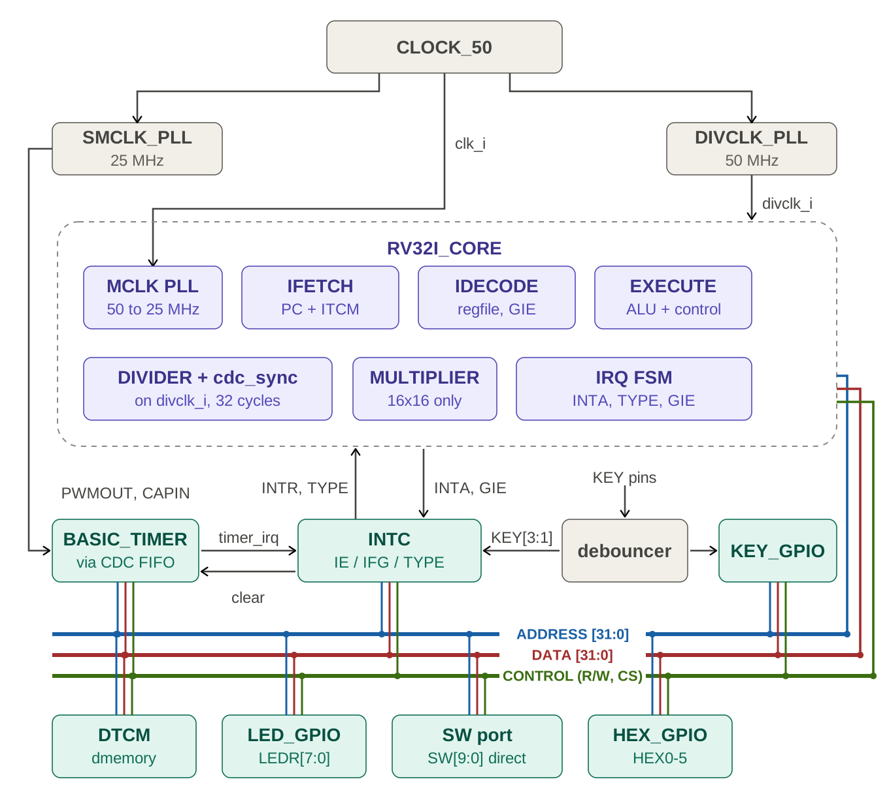
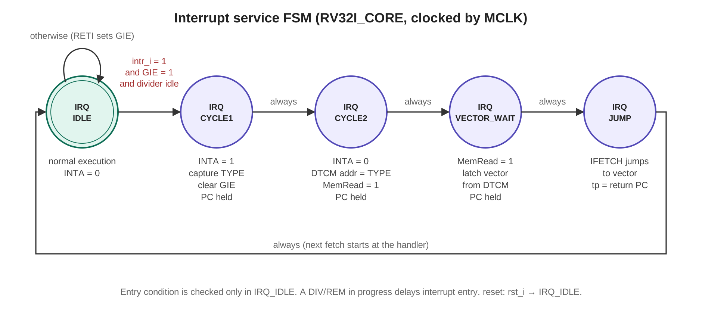

# RV32IM Single-Cycle MCU on FPGA

A single-cycle RV32IM RISC-V core with memory-mapped peripherals, interrupts and a hardware divider, written in VHDL and run on an Altera/Intel FPGA board.

Final project of the lab course *Advanced CPU Architecture and Hardware Accelerators* (361-1-4693), Ben-Gurion University of the Negev.

## Block diagram

The core connects to the peripherals through a shared bus (address, data and control). The core and the peripherals run on separate clocks, generated by PLLs from the 50 MHz board clock.

## Features

- RV32I base ISA plus the M extension: `mul` through a 16x16 multiplier, `div`/`rem` through a 32-cycle hardware divider
- Memory-mapped peripherals: LEDs, six 7-segment displays, switches and push-buttons
- Push-buttons with a hardware debouncer
- Basic Timer in its own clock domain, with a 32-bit counter, PWM output compare and input capture
- Interrupt controller with a vector table in the data memory
- Clock-domain crossing between the core, the divider and the timer, using handshakes and an asynchronous FIFO
- SignalTap debugging on the board

## Interrupts

Interrupt entry is a five-state FSM in the core. Return from interrupt is the ordinary instruction `jalr x0, 0(tp)`, where `tp` (x4) holds the return address.

## Note

The core is built on files provided by the course staff (Copyright Hananya Ribo, BGU), which are not included here. This repository contains only the files written for this project.

## Tools

Quartus, ModelSim, SignalTap

## Authors

Hamza Alhote, Asmaa Jramnh
